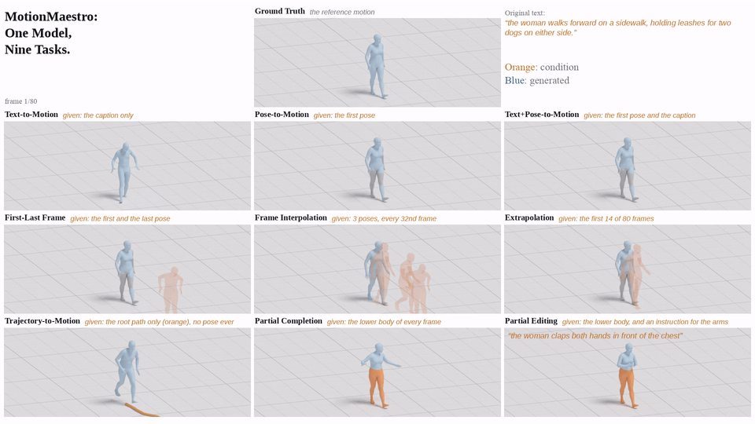
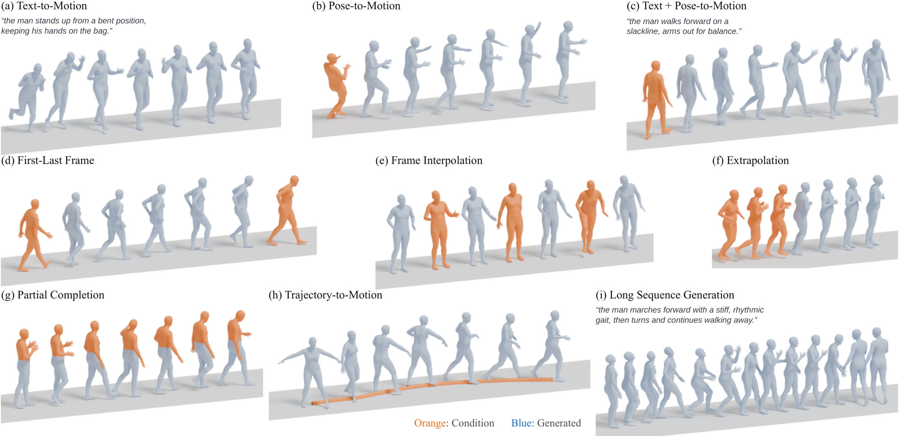
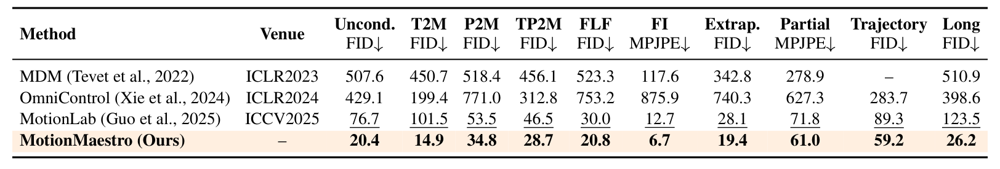
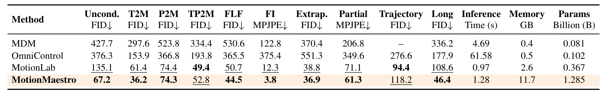
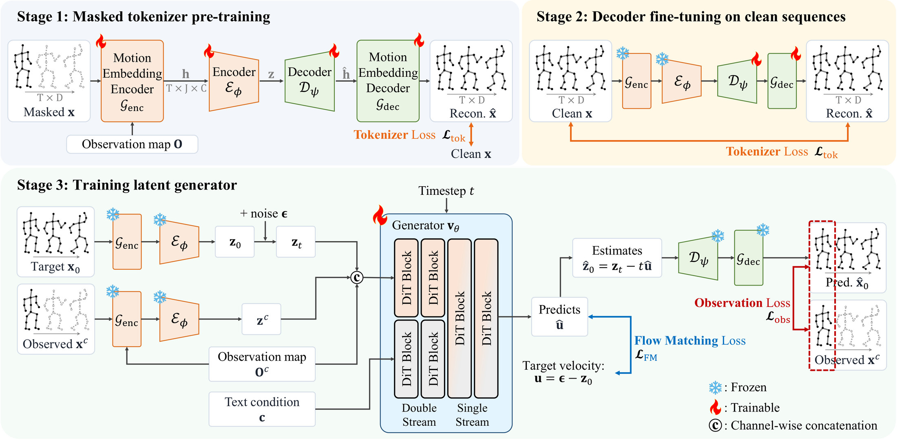

<p align="center">
  <picture>
    <source media="(prefers-color-scheme: dark)" srcset="assets/logo_dark.svg">
    
  </picture>
</p>

<div align="center">
<h2>MotionMaestro: Masked Tokenization for Unified Motion Generation</h2>

<div>
    <a href='https://therealchenyun.github.io/' target='_blank'>Yun Chen</a>&nbsp;&nbsp;&nbsp;&nbsp;
    <a href='https://www.viclab.kaist.ac.kr/' target='_blank'>Munchurl Kim</a><sup>†</sup>&nbsp;&nbsp;&nbsp;&nbsp;
    <a href='https://jeonghyeokdo.github.io/' target='_blank'>Jeonghyeok Do</a><sup>†</sup>
</div>
<div>
    Korea Advanced Institute of Science and Technology (KAIST), South Korea
</div>
<div>
    <sup>†</sup>Co-corresponding authors
</div>
<br>
<div>
    <h4 align="center">
        <a href="https://kaist-viclab.github.io/MotionMaestro_site/" target='_blank'></a>
        <!-- ARXIV_BADGE_START -->
        
        <!-- ARXIV_BADGE_END -->
        
    </h4>
</div>
</div>

---

<div align="center">
    <h4>
        This repository is the official implementation of "MotionMaestro: Masked Tokenization for Unified Motion Generation".
    </h4>
</div>

<div align="center">
    <a href="https://kaist-viclab.github.io/MotionMaestro_site/" target='_blank'>
    
    </a>
    <p><sub>One model, nine tasks. <b>Orange</b>: condition, <b>blue</b>: generated. Demo settings: keyframes every 32nd frame; the lower body is given for partial completion and zero-shot editing.</sub></p>
    <p>▶️ <a href="https://kaist-viclab.github.io/MotionMaestro_site/" target='_blank'><b>More videos on the project page</b></a></p>
</div>

## 📧 News
- **Sep 2026:** This repository is created. The code will be released soon.

## 📖 Abstract
Human motion generation plays an important role in applications such as character animation, virtual environments, and embodied interaction. While existing approaches have achieved remarkable progress, many of them are developed for individual tasks, including text-to-motion, pose-conditioned generation, and trajectory control. Although these tasks involve different types of conditions, a unified framework capable of handling them within a common representation would greatly simplify motion generation systems. We observe that diverse motion conditions can be naturally formulated as different observation patterns over motion sequences, where each task corresponds to a specific masking strategy. Based on this insight, we introduce **MotionMaestro**, a unified motion generation framework that learns a shared representation for complete motions and heterogeneous partial observations through masked motion tokenization. MotionMaestro employs a three-stage training strategy that first learns a masked motion tokenizer, then refines its reconstruction ability on clean motions, and finally trains a conditional flow-matching generator in the learned latent space. Furthermore, we introduce an observation map and an observation loss to explicitly preserve provided motion conditions during generation. With this unified representation and conditioning mechanism, MotionMaestro supports text-guided and unconditional synthesis, pose conditioning and partial completion, temporal interpolation, trajectory control, and motion continuation. Experiments on the large-scale RoMo and MotionMillion datasets show state-of-the-art performance across diverse motion generation tasks.

## 📊 Results

### One Model, Nine Tasks
<div align="center">
    
</div>
<p align="center"><sub><b>Figure 1.</b> Nine tasks with a single MotionMaestro model. <b>Orange</b>: provided motion conditions; <b>blue</b>: generated motion.</sub></p>

### Quantitative Comparison
MotionMaestro achieves the best results on all ten tasks on RoMo and on eight of ten on MotionMillion, with one generator checkpoint per dataset.

<div align="center">
    
</div>
<p align="center"><sub><b>Table 1. Unified motion generation on RoMo.</b> Each method is evaluated on its supported tasks. FI and partial completion report MPJPE (mm) over unobserved frames and joints, respectively; the remaining tasks report FID. Lower is better. <b>Bold</b> and <ins>underlined</ins> values mark the best and second-best results per task. Results for MotionMaestro-5B, scaled up from our default 1.3B model, are provided in the <i>Appendix</i>.</sub></p>
<br>
<div align="center">
    
</div>
<p align="center"><sub><b>Table 2. Unified motion generation and computational cost on MotionMillion.</b> Evaluation settings, metrics, and notation follow Table 1. We additionally report computational cost.</sub></p>

More results and videos: [project page](https://kaist-viclab.github.io/MotionMaestro_site/).

## 🖼️ Method Overview

<div align="center">
    
</div>

Every task is a masking pattern over the motion sequence.
- **Masked motion tokenizer.** Task-aligned masked reconstruction learns one latent space for complete motions and partial observations.
- **Decoder refinement.** With the encoder frozen, the decoder is fine-tuned on clean motions to improve reconstruction.
- **Conditional flow matching.** A flow-matching generator in the frozen latent space takes an observation map; an observation loss encourages outputs to match the given conditions.

## 🚀 Code Release Plan
**The code and pretrained models will be released soon.**

- [ ] Inference code
- [ ] Pretrained models
- [ ] Motion tokenizer
- [ ] Training scripts
- [ ] Evaluation scripts

## 📑 Citation
If you find MotionMaestro useful, please consider citing:
```BibTeX
@article{chen2026motionmaestro,
  title={MotionMaestro: Masked Tokenization for Unified Motion Generation},
  author={Chen, Yun and Kim, Munchurl and Do, Jeonghyeok},
  journal={arXiv preprint arXiv:XXXX.XXXXX},
  year={2026}
}
```
